```{=html}
<style>
main table { width: 100%; table-layout: fixed; font-size: 0.9rem; }
main th, main td { overflow-wrap: anywhere; vertical-align: top; }
main table code { white-space: normal; overflow-wrap: anywhere; }
main figure img { width: 100%; height: auto; }
</style>
```

[Milestone reports](index.html) · [GA4-1 measurement blueprint](ga4-1-analytics-blueprint.html)

# Purpose and Scope

This log compares the PhD Orthodontics implementation with the existing GA4-1 Event / Parameter Map. The Canvas assignment and repository blueprint were reviewed before testing. QA was performed on **November 4, 2026, approximately 9:45–9:58 p.m. Pacific**, using desktop Chrome in the signed-in school profile. GA4 reporting checks use **October 7–November 3, 2026 (Last 28 days)**. Admin's Recent events inventory uses its own last-28-days window; it is not a controlled test-session log.

::: {.callout-warning title="Overall result: PARTIAL — live retest made progress; funnel acceptance remains open"}
The initial 9:45–9:58 p.m. checks were blocked by a certificate warning. A later live retest (approximately 10:42–10:45 p.m. Pacific, November 4) connected on the `www` hostname and exposed a page-view payload and sent-hit summary through Chrome's accessibility view. That retest is documented below and supersedes the initial connection-only findings. The browser inspection connection continued to time out, and screenshots frequently returned blank or outdated content. The new observations therefore have accessibility-text evidence, not reliable new screenshot proof. Full event, form, duplicate and DebugView acceptance is still incomplete; no requirement is marked passed solely from a Connected badge.
:::

## Live Retest — First Connected Findings

After the user restored website access, Tag Assistant connected to `https://www.phdorthodontics.com/` with its debug signal enabled. The user-handled security state was not changed or bypassed by the assistant. The initial screenshots below are retained as a dated record, not as the final state of this retest.

**Evidence quality:** The following values were read from Tag Assistant's native Chrome accessibility panel. They were not inferred from historical reports. Attempts to save current screenshots returned a blank panel; these unusable images are not included as successful evidence. Private local inspection notes retain the observations, but client/session identifiers, full debug tokens and raw diagnostic files are excluded from the public report. A readable screenshot and GA4-side expanded event should still be captured before claiming screenshot-backed acceptance.

| Live check | Direct observation | Result and limit |
|----|----|----|
| On-page destinations | Homepage detected `GTM-KRNXX9TF`, `GTM-WN7FZBMP`, `AW-17603400128`, `G-XRPHCNHL18`, and `G-1K6VTJHYM3` | Expected receiving ID is live. Additional destinations require owner review; multiple IDs alone do not prove duplicate events or a wrong-property defect. |
| Expected stream / source | `G-XRPHCNHL18` details identify an on-page `gtag('config')`, with Google tag ID `GT-T9BHGBCS`. Hits Sent contains a Page View to this measurement ID | Live destination observed; workspace ownership, all collection paths and processed arrival are not fully validated. |
| Homepage page-view payload | Hit Details shows `en = page_view`, `tid = G-XRPHCNHL18`, `_dbg = 1`; `dl` is the `www` homepage with the Tag Assistant debug query; `dr = https://tagassistant.google.com/`; `dt = PhD Orthodontics – PhD Orthodontics`; numeric `sid` is present | Event, destination, URL, referrer, title, debug flag and native session context observed. Wire-format `sid` is not a separately validated GA4 DebugView `ga_session_id` parameter. URL sanitization is not accepted: the debug query and QA referrer remain in this sample. |
| One hero Request Appointment activation | After accepting the cookie banner, the homepage hero CTA was activated once; address/title changed to `/request-appointment/` / Request Appointment – PhD Orthodontics | Navigation works in this retest. No `consultation_cta_click`, `cta_id` or `cta_location` appeared in the expected stream's inspected sent-hit summary. This is a failed observation of the planned CTA contract for this action, not proof that no implementation exists anywhere. |
| Limited page-view duplicate check | Expected stream summary lists exactly two Page View hits and one User Engagement hit across the homepage and appointment parent page; Pages Tagged shows 2/3 pages | No extra page-view hit is visible in this small two-page summary. This does not certify same-destination duplication across all containers, reload/history behavior, other pages, or delayed hits. Form/callback duplicate checks were not executed. |
| Engagement | `user_engagement` appears in the timeline and User Engagement in Hits Sent for the expected stream | Live name/destination observed; `engagement_time_msec` value could not be expanded. PARTIAL. |
| Appointment provider boundary | Tag Assistant adds an Appointments • Greyfinch page, reports `greyfinch.com` is not enabled for debugging, and detects `GTM-KTF69MW` / `G-YBPZ3HS7F1` in the expanded session | Provider boundary observed; provider ownership, destination mapping and cross-domain/session continuity remain unverified. The expected tag's 2/3 coverage is not proof every embedded provider page should carry it. |
| Form start / accepted request | Appointment page content became unavailable to Computer Use; no reliable field interaction, accepted request, or callback test completed | `form_id`, `lead_type`, first-interaction behavior and success deduplication remain NOT TESTABLE. No patient information or fabricated inquiry was submitted. |

**Updated issue status:** QA-01 is **partially mitigated**: the `www` homepage and appointment navigation worked, while inspection reliability and the treatment-page retest remain unresolved. QA-02 remains **unresolved**: Tag Assistant explicitly reported no access to `GTM-KRNXX9TF`; no client workspace was opened or edited. QA-03 now includes a specific controlled CTA action with no planned custom CTA hit in the inspected stream. QA-05 is **partially mitigated** by the page-view payload and limited hit-count evidence; GA4 DebugView arrival, remaining parameters and comprehensive duplicates still require testing. QA-06 remains unresolved, with the additional live GA4 destination requiring an owner-confirmed mapping. QA-04, QA-07 and QA-08 were not re-tested and retain their initial status.

**Next acceptance run:** Restore stable inspection, obtain owner access to both live GTM containers, capture readable screenshots, and expand the expected stream's events in GA4 DebugView. Test Smile Arc plus header/main CTA placements individually; inspect engagement timing and repeat/reload/history behavior. In an approved isolated provider test, validate first interaction, consistent form/session values, actual accepted-request callback and once-only `generate_lead`. Do not treat appointment-page load or a form submission attempt as successful acceptance.

## Follow-up Diagnosis — November 4, Approximately 10:57–11:01 p.m. Pacific

This follow-up used the existing report and GA4-1 map; it did not replace the report. Browser inspection timed out again. Native Chrome accessibility exposed some current Tag Assistant and Elements content, but screenshots returned blank and DOM search results became unreadable. These observations are **PARTIAL** evidence, not new screenshot-backed PASS results.

### Hero CTA and Workspace Decision

The homepage hero control is exposed to accessibility as **button — Request Appointment**, below “You Change The World,” at `https://www.phdorthodontics.com/`. Accessibility role does **not** establish the underlying HTML tag. The Elements search found four matches for Request Appointment, but selected DOM rows were blank; the actual element tag, ID, classes, unique selector and data attributes could not be read. An attempted element-inspector selection instead activated the control and navigated to `/request-appointment` (without a trailing slash). That action was in the original site tab, not a newly verified workspace Preview session; it is not counted as a clean new event-firing or duplicate test.

| Requested check | Actual result | Status |
|----|----|----|
| Hero DOM / selector | Visible text and accessibility role established; exact HTML element, selector, ID/classes/data attributes unavailable | **PARTIAL** |
| Click variables / event | Fresh Click ID, Click Classes, Click URL, Click Text and GTM event name could not be inspected. Navigation destination is not substituted for the Click URL variable | **NOT TESTABLE** |
| Fired / not-fired tags | Tag Assistant's Tags view explicitly states “You do not have access to this container” for `GTM-KRNXX9TF` | **NOT TESTABLE** |
| Existing `consultation_cta_click` tag and trigger | Tag inventory, event name, destination, trigger conditions/page restrictions and parameter mappings inaccessible | **NOT TESTABLE** — tag absence is not established |
| Exact cause of earlier missing CTA hit | Earlier inspected stream summary lacked the planned hit; no selector/text/URL/path/tag mismatch can be established without tag/trigger and click-variable evidence | **NOT TESTABLE** — root cause remains unknown |
| Workspace repair / parameter mapping | No client workspace was available. No tag, trigger or variable was created or changed; no actual `cta_id` or `cta_location` value validated | **NOT TESTABLE** |
| Fix Preview and GA4 arrival | No fix existed to Preview-test; no new expanded CTA event in GA4 DebugView was verified | **NOT TESTABLE** — no PASS IN PREVIEW claim |

**Access verification:** Clearing the GTM Accounts name filter showed one unrelated Blogger container (`GTM-KS9KHLWL`), not either live PhD Orthodontics container. The unrelated container was not edited. The site owner must provide appropriate workspace access to the actual owning container and read/diagnostic access to the other live container for overlap review. No access permissions were changed by the assistant.

### Actual Installation Topology Observed

| Surface | Direct observation | Interpretation / status |
|----|----|----|
| Homepage Elements panel | Separate script elements reference `https://www.googletagmanager.com/gtag/js?id=G-1K6VTJHYM3` and `https://www.googletagmanager.com/gtag/js?id=G-XRPHCNHL18` | **PARTIAL**: two DOM Google tag references confirmed. Their WordPress/plugin/vendor source and whether any reference was injected by another script remain unverified. |
| Tag Assistant secondary destination | `G-1K6VTJHYM3` / `GT-KD7C5M8L`; source shown as on-page `gtag('config')`; summary contains two Page View hits and one User Engagement hit over the existing two parent pages | **PARTIAL**: more than one GA4 destination sends page views. This does not prove an extra hit to the same measurement ID. |
| Expected destination | Earlier retest: `G-XRPHCNHL18` / `GT-T9BHGBCS`, on-page `gtag('config')`; two Page View hits across the two parent pages | **PARTIAL**: retain earlier limited count; no fresh three-page acceptance run completed. |
| Homepage GTM / Ads | `GTM-KRNXX9TF`, `GTM-WN7FZBMP`, `AW-17603400128` detected in Tag Assistant; selected first GTM source is on-page `gtm.js` snippet | **PARTIAL**: container detection is not a readable inventory of tags or triggers. First GTM Hits Sent shows no hits, while Tags view denies access; do not infer that its tag inventory is empty. |
| Appointment session / provider | Earlier retest adds Appointments • Greyfinch, `GTM-KTF69MW`, `G-YBPZ3HS7F1`, and unknown-domain debug notice for `greyfinch.com` | **PARTIAL**: exact provider-to-parent event transport, ownership and success callback are unverified. |

### Form and Duplicate Acceptance Still Required

| Item | Current result | Status |
|----|----|----|
| `form_start` implementation | Initial GA4 Admin evidence shows enhanced form measurement enabled and historical `form_start`; current manual tags are inaccessible. Appointment-page content was unavailable, so no genuine safe field interaction completed | **PARTIAL** |
| Automatic/manual form duplication | Neither live first-interaction behavior nor manual overlap could be inspected; no manual event was added | **NOT TESTABLE** |
| `form_id` / form URL | `form_id = consultation_request` remains the proposed GA4-1 analytics code; no emitted form value or form-start `page_location` verified | **NOT TESTABLE** |
| Successful-request mechanism | Greyfinch provider boundary observed; no accepted-state confirmation page, AJAX response, DOM success message, callback or dataLayer contract inspected | **PARTIAL** for provider identification; exact success mechanism **NOT TESTABLE** |
| Safe `generate_lead` validation | No approved isolated provider test or accepted-state callback available. **Implementation requires website/form-provider support or an approved test submission mechanism.** Required dependency: owner-supported accepted-request signal for this embedded flow, stable form mapping, same-session context, and once-only handling of repeated acceptance notifications | **NOT TESTABLE** |
| Existing `form_submit` / `ads_conversion_Book_appointment_1` | Historical names recorded in the initial inventory; current trigger, parameters, success semantics and duplicate behavior remain inaccessible. Neither is reused as `generate_lead` | **PARTIAL** for inventory only |
| Homepage / request page duplicate QA | Existing two-page sample: two expected-destination views; secondary destination also has two views. No comprehensive repeat/reload/back test completed | **PARTIAL** |
| Smile Arc service page duplicate QA | No new measured page-load, navigation or back test completed in this follow-up; initial certificate-blocked attempt is retained below | **NOT TESTABLE** |

### Current Issues and Change Register

| Issue | Precise current finding / action | Current status |
|----|----|----|
| QA-01 | `www` navigation previously worked; browser inspection still times out and screenshots/DOM views return blank or outdated content. No reliable three-page retest | **Partially resolved** |
| QA-02 | Full Accounts list lacks client containers; explicit `GTM-KRNXX9TF` access denial prevents tag/trigger inspection or workspace repairs | **Unresolved** |
| QA-03 | Earlier hero action had no planned CTA hit in the inspected stream. Exact reason unknown because tag existence, trigger conditions and click variables are inaccessible; no fix prepared | **Unresolved** |
| QA-04 | Ads-named key-event trigger and accepted-request semantics remain unknown | **Unresolved** |
| QA-05 | Selected earlier page-view values observed; fresh CTA/form/engagement parameter screenshots, GA4 arrival and comprehensive duplicate QA remain missing | **Partially resolved** |
| QA-06 | Additional live GA4 destination now confirmed to send page views; ownership and canonical destination mapping still unapproved | **Unresolved** |
| QA-07 / QA-08 | Historical QA referral contamination and absent BigQuery link were not re-tested | **Unresolved** |

**Every GTM workspace change made: none. Unpublished proposed workspace changes: none.** No tracking configuration was saved, submitted or published. Only this documentation was updated. A production fix is not implied.

**Remaining high risk:** Successful form submission tracking depends on the form provider/website success callback and remains unvalidated. The owner must expose an approved accepted-request signal and safe test mechanism, then validate matching `form_id`, `lead_type = consultation_request`, sanitized URL/session context and callback/reload deduplication. Until that is done, inquiry-rate and attribution analysis must not use these unverified events as trusted business outcomes.

No GTM publication, GA4 setting change, website edit, BigQuery activation, or form submission was performed. No patient or synthetic inquiry was created. The 16 figures below were captured during the initial 9:45–9:58 p.m. QA window. The later retest has separately labeled accessibility-text observations; no blank retest capture is presented as proof. Demo-property screenshots were not used.

## Initial Property and Collection Configuration

The supplied GA4 URL identifies property **540432856** under account **396896788**, displayed as **phdorthodontics.com**. Two web streams are present in that property:

| Stream | Measurement ID | Admin observation | Interpretation |
|----|----|----|----|
| `phdorthodontics.com` (stream 15013125726) | `G-XRPHCNHL18` | Data collection active in the past 48 hours | Receiving stream in the supplied property; this does not identify every live on-page destination. |
| `PhD Orthodontics` (stream 16133876327) | `G-J1RJZW4VBV` | No data received; collection not active | Second stream is inactive. Client/vendor must confirm the canonical destination. |

**Initial mismatch assessment:** Two streams in one property are not proof of a wrong-property installation. Initial debugging failed; the later retest above established that `G-XRPHCNHL18` is live and found additional destinations. Their owning properties and intended roles remain unverified; do not label the earlier mismatch fixed or present solely from these screens.

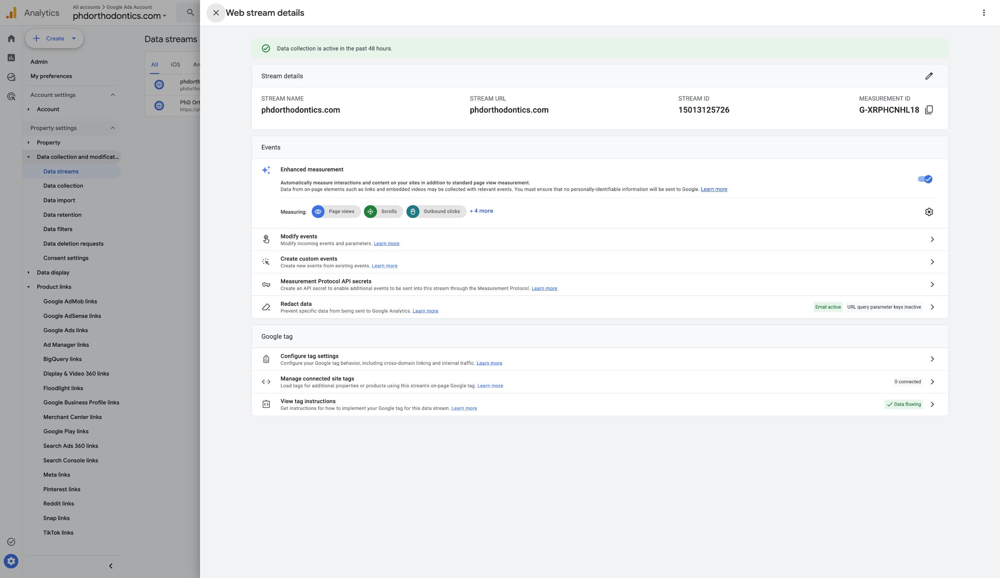{#fig-active}

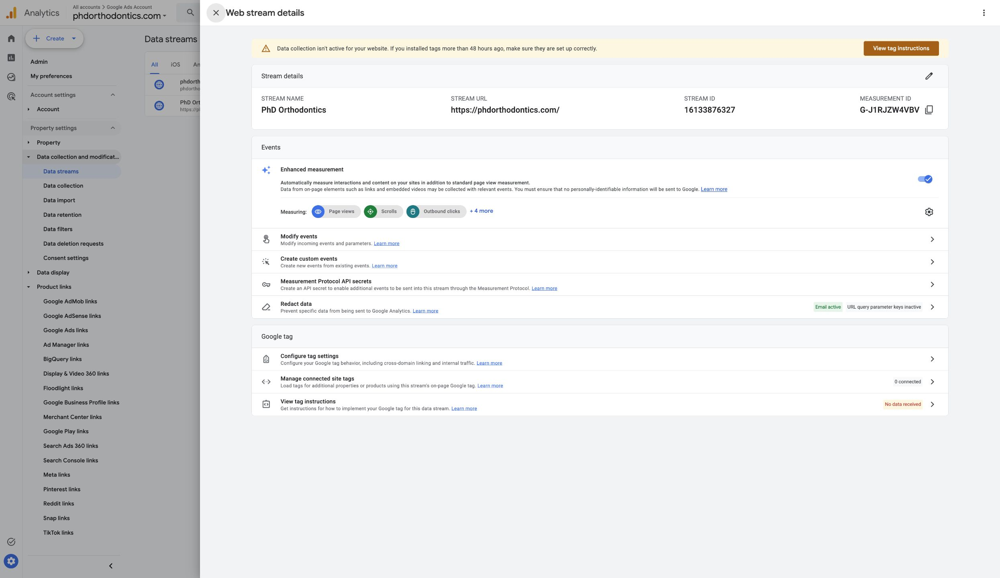{#fig-inactive}

The receiving stream has enhanced measurement enabled, including page views and form interactions. Email redaction is active; URL query-parameter key redaction is inactive. This is configuration evidence, not proof that all outgoing URLs or parameters are free of sensitive information.

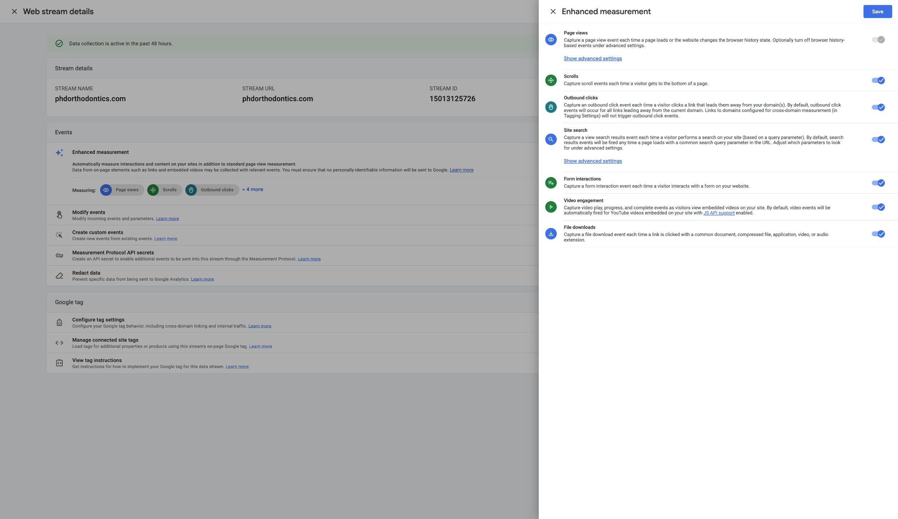{#fig-enhanced}

# GA4-1 Measurement Reference — Initial Comparison

The existing repository QMD and the supplied rendered GA4-1 HTML agree on the following measurement contract. The KPI branches remain Acquisition, Engagement, Conversion Funnel, and Lead Quality.

| Event | Blueprint trigger | Parameters to verify | Current evidence / reconciliation |
|----|----|----|----|
| `session_start` | Native session begins; never add a manual GTM session-start tag | `ga_session_id`; native session context | Listed in Recent events; native origin/session ID not verified. **PARTIAL**. |
| `page_view` | Approved page load or supported history change; one collection method | Sanitized `page_location`, `page_referrer`, `ga_session_id` | Recent events and processed page reports exist; live firing/duplicates not verified. **PARTIAL**. |
| `user_engagement` | Native engagement collection | `engagement_time_msec`; session context | Listed in Recent events; raw event count is not Engaged sessions. **PARTIAL**. |
| `consultation_cta_click` | One event per designated CTA activation | Static `cta_id`, `cta_location`, sanitized `page_location`; session context | Not listed in Recent events; fresh CTA validation blocked. Implementation cannot be verified due to access/connection. **NOT TESTABLE**. |
| `form_start` | First actual interaction with the designated form in a session | Stable `form_id`, sanitized `page_location`; session context | Listed in Recent events; enhanced form interactions enabled. Designated form, first-interaction behavior and duplicate control unverified. **PARTIAL**. |
| `generate_lead` | Confirmed successful server/provider acceptance, once per accepted request | Same `form_id`; `lead_type = consultation_request`; sanitized `page_location`; session context | Not listed in Recent events. No safe success-test mechanism established; configuration inaccessible. **NOT TESTABLE**. |

`form_id = consultation_request` is the blueprint's proposed analytics code, not a verified HTML ID. Neither an alternative form ID nor any CTA code was approved or validated in this session. Missing inventory entries demonstrate an evidence gap, not definitive absence of implementation.

**Counting contract:** Consultation Inquiries are deduplicated confirmed successful requests. Form Completion Rate uses distinct started sessions with a subsequent same-form `generate_lead` in the same session/reporting period divided by distinct started sessions; count each session once, show N/A for zero starts, and report leads without starts separately. Qualified Consultation Leads require client-defined criteria and validated inquiry/CRM records. CTA clicks, telephone clicks, form openings, `form_submit`, platform key events, inquiries, qualified leads and booked appointments are separate concepts.

# Deliverable 1 — Initial Screenshot-Backed QA Checklist

**Result labels:** PASS means the stated check has screenshot support within its limited scope; FAIL means a directly observed expected behavior failed; PARTIAL means some evidence exists but acceptance criteria remain unverified; NOT TESTABLE means access, safety or environment prevents validation; NOT IMPLEMENTED means an inspected feature is demonstrably absent. A reporting-dimension PASS does not certify live collection or conversion tracking.

The following checklist records the **initial 9:45–9:58 p.m. window**. Its blocked results are retained for traceability; the later Live Retest section above provides current updates.

## A. GTM / Collection Layer

### Test Environment and Access

GTM's loaded Accounts list contained an unrelated container but no visible PhD Orthodontics container; filtering for `phd` returned No Results in the current account. Google tags are a separate view and do not establish access to a GTM workspace, tags, triggers or variables. A current container ID, workspace version, custom event tags, and trigger selectors could not be verified.

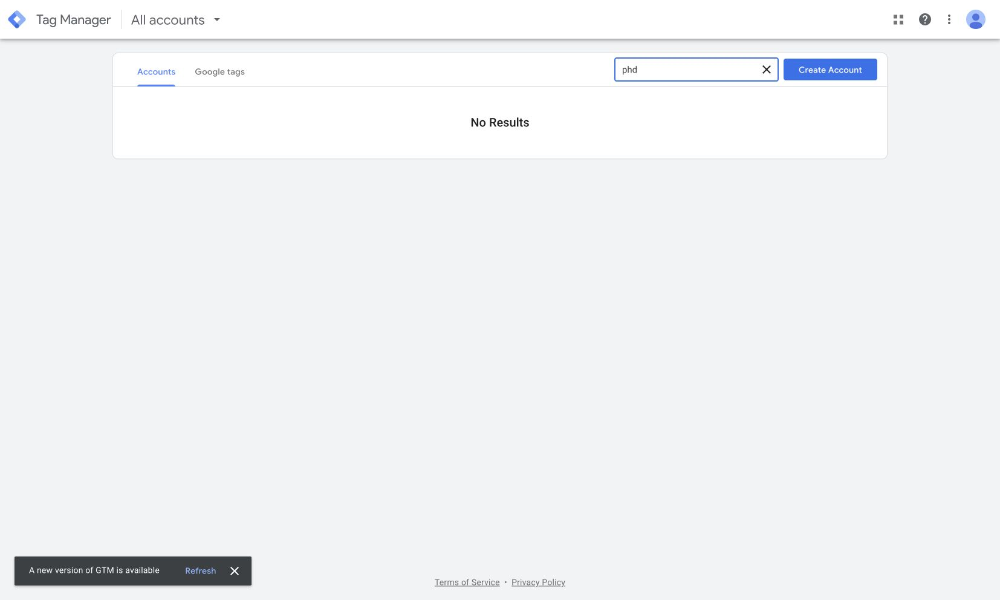{#fig-gtm-access}

A Tag Assistant connection was attempted for `https://phdorthodontics.com/` with its debug signal enabled. The first attempt encountered the browser certificate warning; a requested retry also timed out. The connection screen's zero-tag state is a connection failure, **not proof that the website has no tags**. Chrome's error was not bypassed by the assistant. The warning's cause may involve the site certificate, a redirect, or the local network/browser environment; a vendor diagnosis is needed before attributing it to the site's public certificate globally.

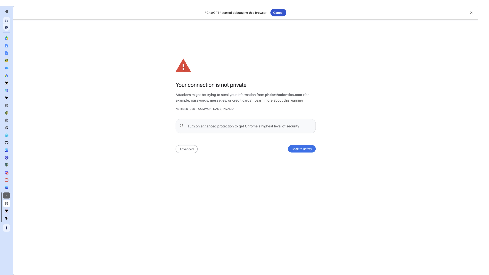{#fig-cert}

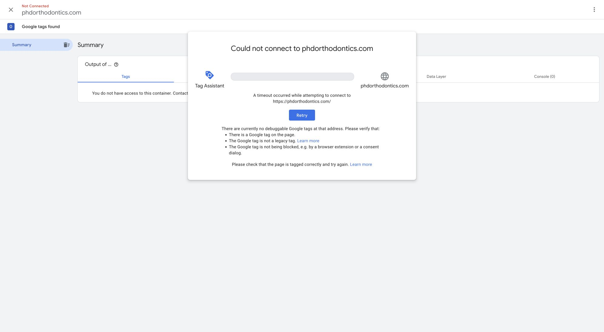{#fig-ta}

### Pages and Actions Attempted

| Page / action | Observed outcome | Live collection acceptance |
|----|----|----|
| Homepage `/` | Existing tab displayed the homepage and its Request Appointment CTAs; fresh Tag Assistant navigation failed | **NOT TESTABLE** for tag firing, live measurement ID and duplicates |
| Treatment `/services/smile-arc/` | Fresh page attempt returned the certificate error | **NOT TESTABLE**; processed historical page reports are separate evidence |
| Consultation `/request-appointment/` | Activating the homepage hero Request Appointment CTA reached a privacy-error page | **NOT TESTABLE**; no successful form interaction or submission |
| Hero/main-content CTA | Activated once from the existing homepage tab; destination blocked | Event firing and parameters **NOT TESTABLE** |
| Header BOOK APPOINTMENT and other main-content CTAs | Present in homepage accessibility/UI context; no additional controlled activation completed | **NOT TESTABLE**; do not generalize from the hero CTA |

### Event Checklist

| Event | Trigger condition | Page/action tested | Expected parameters | Duplicate check | Result | Evidence |
|----|----|----|----|----|----|----|
| `page_view` | One collection path per page load/history change | Homepage debug connection; Smile Arc attempt; appointment CTA navigation | `page_location`, `page_referrer`, `ga_session_id` | Automatic/manual overlap could not be inspected | **PARTIAL**: processed page data exists, fresh firing blocked | @fig-active, @fig-enhanced, @fig-ta, @fig-path |
| `consultation_cta_click` | Once per designated CTA activation | One hero Request Appointment activation | `cta_id`, `cta_location`, `page_location`; session context | Not verified | **NOT TESTABLE**; absent from recent inventory, not proof of no tag | @fig-ta, @fig-recent |
| `form_start` | First actual interaction, not appointment-page load | Appointment navigation blocked; no field interaction | `form_id`, `page_location`; session context | Enhanced/manual overlap and repeat interaction not verified | **PARTIAL**: historical event present, intended trigger unvalidated | @fig-enhanced, @fig-recent |
| `generate_lead` | Confirmed accepted consultation request; suppress retries/reloads | No submission attempted; safe test mechanism not established | Matching `form_id`, `lead_type = consultation_request`, `page_location`; session context | Callback/reload deduplication not verified | **NOT TESTABLE** | @fig-recent, @fig-ta |
| `session_start` | Native session collection only | Recent event inventory inspected | `ga_session_id`; native context | Manual session tag cannot be excluded without container access | **PARTIAL** | @fig-recent |
| `user_engagement` | Normal GA4 engagement behavior | Recent event inventory inspected | `engagement_time_msec`; session context | Not verified; use native Engaged sessions metric | **PARTIAL** | @fig-recent |

**Duplicate-firing finding:** No duplicate was established or ruled out. Multiple tags, historical totals, or repeated page views would not alone prove duplicates. Rerun one controlled action at a time and inspect the event timeline, tag destinations and parameter values once access is restored.

**Successful submission safety:** Unable to perform a real production successful-form test without creating a false client inquiry. No staging/test form, approved provider callback test, or safe demo mechanism was established during this blocked session. Do not manufacture a success event or submit fake patient details. The vendor must supply an approved isolated test and acceptance callback for the same-form/deduplication test.

## B. GA4 DebugView / Realtime

DebugView showed **0 debug devices** and no development-device events in the last 30 minutes. Realtime showed **0 active users** and no event rows at capture time. Neither view supplied an event that could be expanded to validate parameters. This is an observed lack of test evidence, not proof that normal collection is entirely broken.

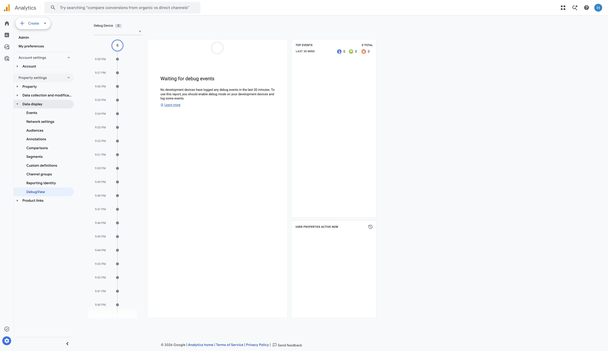{#fig-debug}

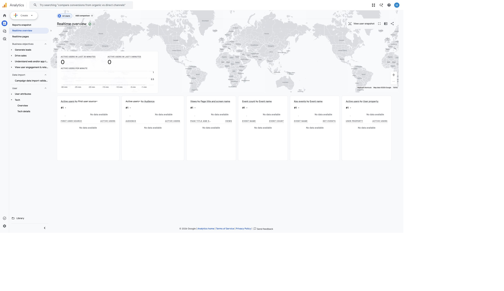{#fig-realtime}

| Check | Required validation | Observation | Result | Evidence |
|----|----|----|----|----|
| CTA arrival and values | Expanded `consultation_cta_click`; stable/populated `cta_id`, `cta_location`, sanitized `page_location` | No debug event available | **NOT TESTABLE** | @fig-debug, @fig-realtime |
| Form-start arrival and values | Expanded `form_start`; stable `form_id`, correct URL, session context | Listed historically; no controlled arrival or parameter values | **PARTIAL** | @fig-debug, @fig-recent |
| Accepted-request arrival | Expanded `generate_lead`; matching form/session; exact `lead_type = consultation_request` | No safe submission; no debug event | **NOT TESTABLE** | @fig-debug, @fig-recent |
| Automatic context | `ga_session_id`, `page_referrer`, `engagement_time_msec` | Event names appear historically; values not expanded | **PARTIAL** | @fig-recent |
| Parameter sensibility / privacy | Populated, stable, consistent codes; no personal/health data | Actual event payload values not available | **NOT TESTABLE** | @fig-debug |

**Parameters successfully validated:** none at the event-payload level. **Missing/inconsistent parameter values:** none proven; their presence and values remain unverified. Do not turn an unavailable parameter inspection into a claim that a parameter is missing.

### Recent Events and Key-Event Reconciliation

The Recent events inventory listed nine names: `ads_conversion_Book_appointment_1`, `click`, `first_visit`, `form_start`, `form_submit`, `page_view`, `scroll`, `session_start`, and `user_engagement`. Neither `consultation_cta_click` nor `generate_lead` appeared. The historical existence of `form_start` does not establish that it is limited to the intended consultation form.

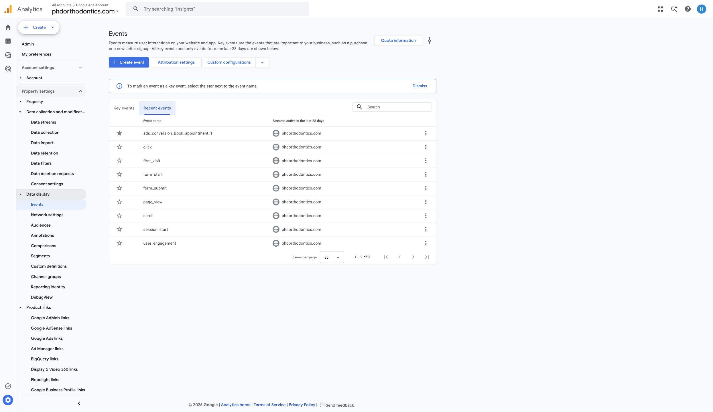{#fig-recent}

The Key events tab listed `ads_conversion_Book_appointment_1` with stream activity and `purchase` with no stream data detected. There is no evidence here that the Ads-named event reflects server/provider acceptance or appointment booking. Its actual trigger is unknown. The Pages and screens report attributes all 12 key events in the reporting window to `/meet-dr-lu/` (@fig-path); inspect this event's source and trigger before using it as an inquiry outcome. Do not rename or remove it without tracing Ads dependencies and obtaining the appropriate approval.

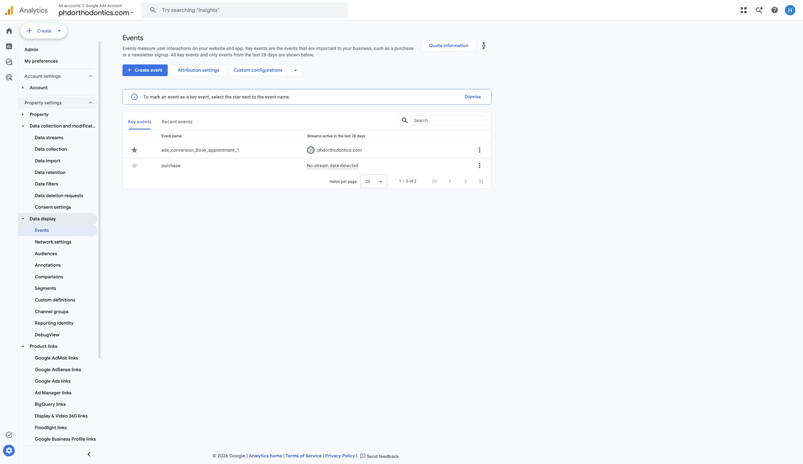{#fig-key}

## C. GA4 Reporting Sanity Checks

The following checks concern **processed dimension population**, not live test attribution, funnel completion or business performance. Date range: October 7–November 3, 2026. Report totals show 152 sessions, 214 views and 693 events; these units are different. No controlled non-debug test visit was successfully reconciled to processed reports.

| Dimension | Report used | What was checked | Finding | Result | Screenshot |
|----|----|----|----|----|----|
| Session source / medium | Traffic acquisition | Populated direct, organic, referral and paid values | `(direct) / (none)` 77 sessions; `google / organic` 62; `bing / organic` 7; Tag Assistant referral 3; AI assistant, Google CPC and another referral 1 each | **PASS**, population only; QA referral contamination requires follow-up | @fig-source |
| Session campaign | Traffic acquisition | Campaign names and default/unknown values | `Kids Orthodontist` and `business-profile` each 1 session; `(direct)` 77, `(organic)` 69, `(referral)` 3, `(ai-assistant)` 1. No `(not set)` row shown in the six-row view | **PASS**, population only; campaign correctness/redirect preservation untested | @fig-campaign |
| Page location | Pages and screens, page path | Expected site paths; malformed values in visible sample | `/`, `/services/smile-arc/`, `/request-appointment/`, and other recognizable paths appear. Full `page_location` including hostname/query was not available in the inspected dimension picker | **PARTIAL**; path is not full URL and cannot certify URL privacy | @fig-path |
| Page title | Pages and screens | Readable titles aligned to recognizable site pages | Homepage, Smile Arc and Request Appointment titles populated; historical homepage title variants exist | **PASS**, title population in visible rows; full-site consistency not certified | @fig-title |
| Device category | Tech details | Populated categories and unknowns in visible rows | Desktop 71 active users, mobile 52; two rows; tablet and `(not set)` not shown | **PASS**, population only; no mobile/browser event parity test | @fig-device |

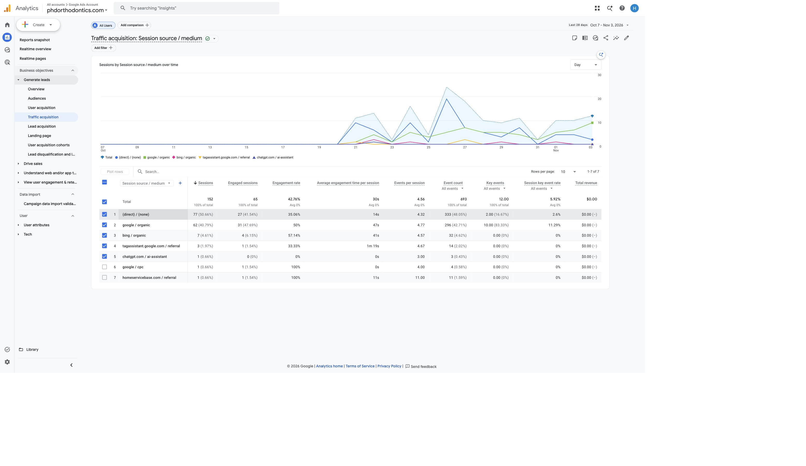{#fig-source}

The seven source/medium row session counts sum to **152**, agreeing with the displayed session total for this view. The 3 Tag Assistant referral sessions indicate QA-related traffic in this historical report; this is not evidence that today's failed connection succeeded. Avoid treating debugging activity as customer acquisition. Agree a future test-traffic policy and document filtering effects before making changes; historic data will retain its limitations.

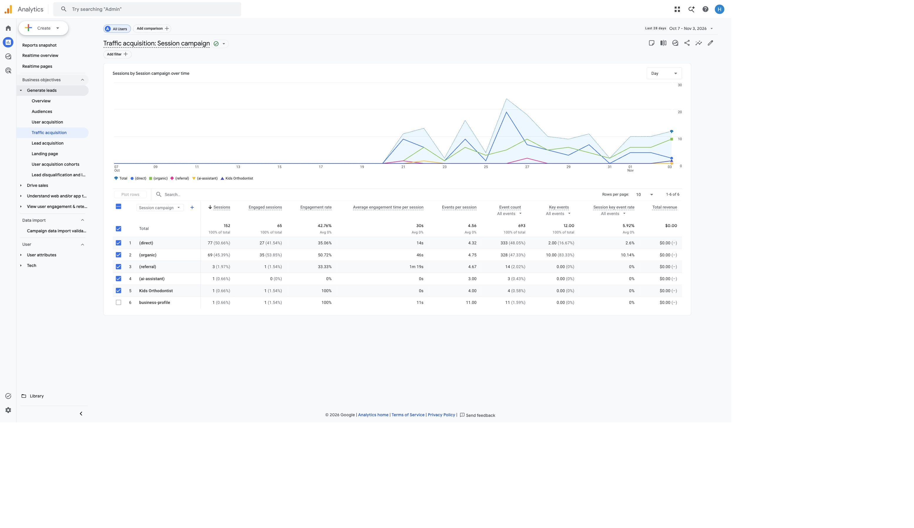{#fig-campaign}

`(not set)` means the selected dimension has no assigned value for those records; the cause depends on dimension scope and available attribution information. A direct or organic visit does not require a manually named campaign. In this view, automatic categories are populated and no `(not set)` row is shown; do not log missing campaign tagging as an observed defect. Named campaigns still need a controlled UTM/auto-tagging and redirect test before campaign accuracy is accepted.

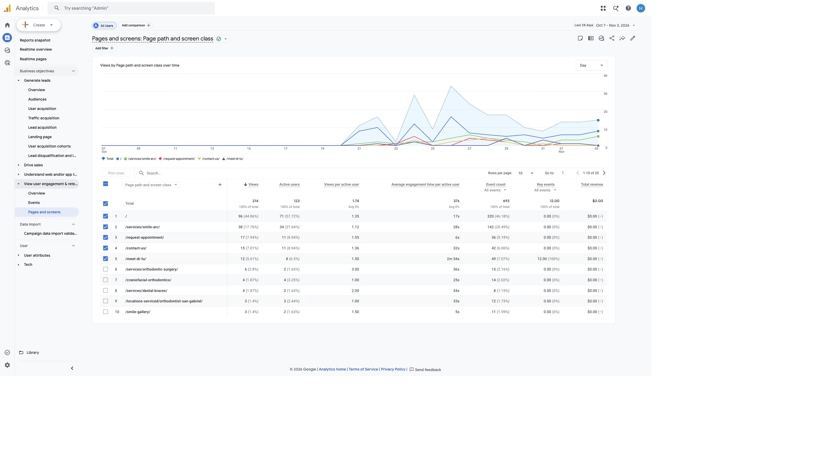{#fig-path}

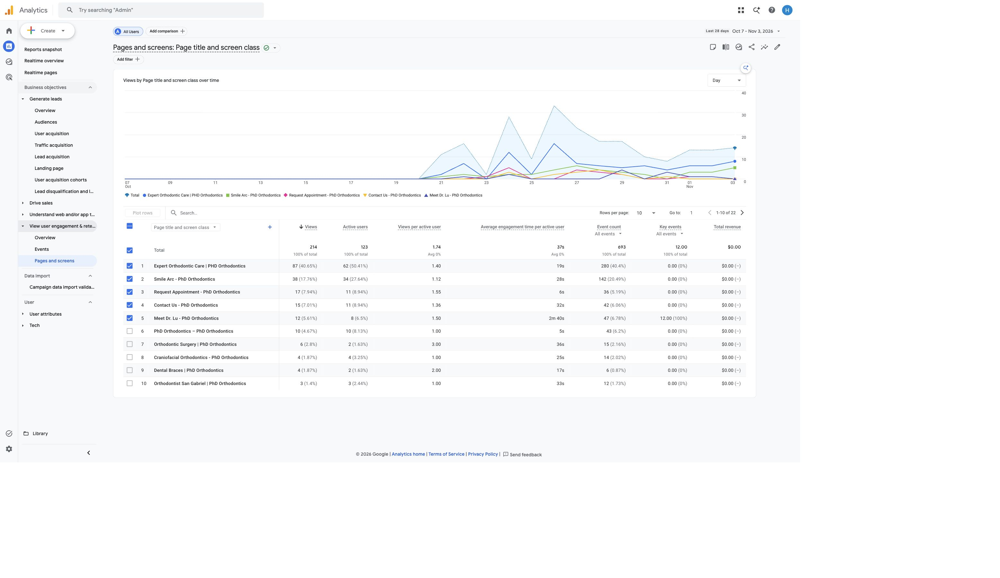{#fig-title}

No PII was apparent in the displayed path/title sample. **That limited observation does not establish that full URLs, query strings, referrers, all historical rows, or event payloads are safe.** No patient inputs were entered. Review URL redaction rules, data-layer values and outgoing payloads with the vendor in an approved test environment.

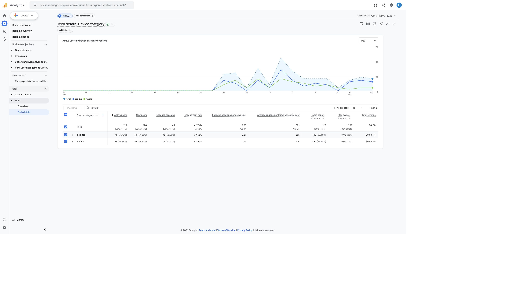{#fig-device}

## D. BigQuery Export

**BigQuery export was not active at the time of QA, so event-level warehouse validation could not yet be performed.** Admin → Product links → BigQuery links states “No links yet.” No export was created or enabled. There is no verified export project/dataset, no `events_*` query output, and no DebugView-to-warehouse reconciliation in this report.

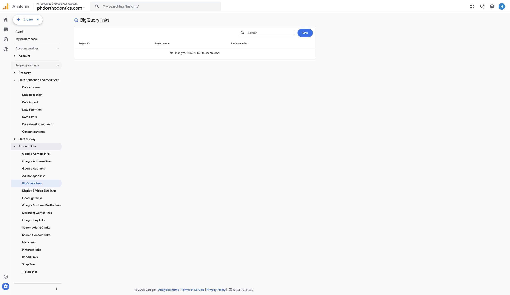{#fig-bq}

| Check | Finding | Result |
|----|----|----|
| Export link exists | No links yet | **NOT IMPLEMENTED** |
| Relevant events in `events_*` | No linked export to inspect | **NOT TESTABLE** |
| `UNNEST(event_params)` extraction | No actual export dataset available; no query run | **NOT TESTABLE** |
| Match event name/parameter/value to DebugView | Neither warehouse data nor successful live debug test available | **NOT TESTABLE** |

**Validation timing and owner:** After the client approves the canonical stream and export setup, the authorized GA4/GCP owner should create the link and grant appropriate access. Recheck when the first daily `events_YYYYMMDD` table appears; check intraday tables only if streaming is enabled. Export start time, timezone and table availability must be recorded; do not assume past data will backfill. On the first available approved QA date, the analytics team should:

1.  Run a bounded date-range event-name/count query for `consultation_cta_click`, `form_start`, and `generate_lead` using the actual project and dataset.
2.  Extract `cta_id`, `cta_location`, `form_id`, `lead_type`, `page_location` and `ga_session_id` using scalar subqueries over `UNNEST(event_params)`, reading the correct string/integer value type.
3.  Match each controlled test's event name, parameter key and actual value with the saved expanded DebugView event; account for export delay, consent and active filters.
4.  Group sessions by `user_pseudo_id` plus `ga_session_id`; flag missing identifiers and avoid combining daily/intraday copies twice.
5.  Apply the GA4-1 same-form/session sequence and deduplication rules before producing completion or attribution metrics. Publish actual SQL/output evidence only after execution; no placeholder dataset is presented as a result here.

# Deliverable 2 — Issues Log (Initial Findings)

These are the initial QA problems or acceptance gaps. Current retest status changes are explicitly recorded in the Follow-up Diagnosis and Live Retest sections above; the original rows remain as a traceable baseline. Suspected causes are hypotheses, not verified configuration defects. No issue is marked fully resolved without complete acceptance evidence.

| ID | Issue | Detected in | Severity | Evidence | Suspected cause | Action/fix attempted | Status |
|----|----|----|----|----|----|----|----|
| QA-01 | Certificate warning and failed Tag Assistant connection prevent fresh collection QA | Chrome / Tag Assistant | **High** | @fig-cert, @fig-ta | Certificate hostname/redirect or local environment problem; root cause not established | Retried connection; attempted appointment CTA and Smile Arc page; stopped at security warning; refer diagnosis to vendor | **Unresolved** |
| QA-02 | GTM workspace/tags/triggers are inaccessible in current account | GTM Accounts | **High** | @fig-gtm-access | Missing container access or different owning account | Inspected Accounts view; no container edits/publish; request authorized owner review | **Unresolved** |
| QA-03 | Planned CTA and accepted-request event names have no observed recent evidence | GA4 Recent events | **High** | @fig-recent | Tags may be absent, named differently, routed elsewhere, or have no eligible recent activity; access prevents distinction | Compared all nine inventory entries with GA4-1; did not fabricate events or substitute `form_submit` | **Unresolved** |
| QA-04 | Existing Ads-named key event is not reconciled to confirmed requests; reported activity is on the doctor page | GA4 Key events / Pages and screens | **High** | @fig-key, @fig-path | Existing trigger may differ from blueprint; accepted-request semantics unverified | Inspected key-event list and page association; keep excluded from inquiry/booking claims pending trigger review | **Unresolved** |
| QA-05 | No current DebugView/Realtime test evidence; required parameter and duplicate checks remain unavailable | DebugView / Realtime | **High** | @fig-debug, @fig-realtime | Failed debug connection; no eligible test device/event visible; other filter effects unverified | Inspected both views after attempts; no payload values asserted; rerun after access repair | **Unresolved** |
| QA-06 | A second stream exists with no data received; canonical stream decision is undocumented in this QA | GA4 Data streams | **Medium** | @fig-active, @fig-inactive | Parallel setup or undeployed stream; not proof of wrong-property traffic | Recorded both IDs; no deletion or rerouting; obtain client/vendor destination decision | **Unresolved** |
| QA-07 | Historical acquisition report includes Tag Assistant referral sessions | GA4 Traffic acquisition | **Medium** | @fig-source | QA visits are present in processed acquisition data; filter policy unverified | Disclosed 3 sessions; do not treat them as patient acquisition; propose approved test-traffic segregation | **Unresolved** |
| QA-08 | Warehouse validation dependency is absent | GA4 BigQuery links | **Medium** | @fig-bq | Export has not been linked | Verified empty link table; no activation; documented validation trigger and plan | **Unresolved** |

No duplicate page/form event, missing specific parameter value, pre-consent firing, leaked PII, or campaign-tagging defect was established. These remain test requirements or risks, rather than invented issue-log findings.

# Deliverable 3 — Remaining Risks & Mitigation Plan

| Risk | Why it matters for KPIs or downstream analysis | Likely impact | Mitigation |
|----|----|----|----|
| Website/vendor dependency and certificate instability | Interrupted browsing or diagnostics can suppress observed funnel steps and delay QA acceptance | **High** | Vendor checks hostname certificate chain/redirects and local-environment differences; retest all three pages before interpreting changes in traffic or inquiries |
| CTA selector changes and desktop/mobile differences | CTA counts and funnel drop-off could become inconsistent across placements/devices | **High** | Approve static CTA codes and selectors; test header, hero/main and other actual placements separately on desktop/mobile after each site update |
| Enhanced measurement overlapping manual implementations | Duplicate views/starts inflate engagement and distort session/form relationships | **High** | Inspect the owning container; use one page-view strategy and one reliable form-start implementation; repeat-action and reload tests with parameter evidence |
| Embedded/provider form behavior or callback changes | A form opening/submit attempt can be mistaken for an accepted request, invalidating the inquiry KPI and Ads optimization | **High** | Confirm actual form/provider; use approved isolated callback tests; tie `generate_lead` to acceptance with same `form_id` and private deduplication token kept outside GA4 |
| Consent and browser privacy differences | Collection/session IDs can vary, biasing device comparisons, BigQuery paths and attribution | **High** | Test approved denied/granted consent states and major browsers; record consent mode/filter state and missing IDs; do not assume counts equal all real inquiries |
| Query strings/referrers may contain sensitive data | Healthcare-related URLs/payloads could expose personal information in GA4, exports or public evidence | **High** | Vendor audits data layer/outgoing payloads; sanitize URLs before collection; retain permitted campaign tags; verify query-key redaction and avoid capturing patient entries |
| Mixed streams and unverified legacy key-event semantics | Looker Studio and Ads reports could combine incompatible populations or label intent as success | **High** | Document canonical property/stream, review destination and legacy triggers with owner, and validate accepted-request semantics before downstream mapping |
| Manual UTMs, redirects and QA contamination | Channel/campaign comparisons and attribution can become misleading even when dimension values are populated | **Medium** | Use an approved naming register, check UTM/auto-tag preservation in controlled non-debug visits, and define prospective QA/internal traffic handling |
| Low volume, processing delay and lack of export history | Sparse results cannot establish tracking completeness; later BigQuery work may lack earlier data | **Medium** | Use bounded QA windows, record processing/export start times, keep absent categories explicit, and validate the first available export rather than assume backfill |
| Inquiry qualification and appointment linkage remain unvalidated | `generate_lead` alone cannot establish qualified leads, patients or bookings for CEP/ROI analysis | **High** | Obtain client-approved qualification rules and privacy-reviewed aggregate inquiry/CRM reconciliation; keep inquiry, qualification and appointment outcomes separate |

# Overall QA Conclusion

**Trustworthy within a narrow scope:** the supplied property has a receiving stream, processed recognizable site pages, and populated source/medium, campaign, title and device dimensions. These reporting checks are useful for descriptive QA, with QA referral contamination disclosed. They do not prove that the blueprint was implemented correctly.

**Fully validated funnel events: none.** The later retest establishes live `page_view` destination and selected wire-format values, a live engagement event name, working hero-to-appointment navigation, and a small two-page hit-count observation. These are substantive improvements over the initial blocked run, but reliable new screenshots and GA4 DebugView confirmation are missing. The planned custom CTA hit was not observed for the one tested hero action. `form_start`, accepted-request `generate_lead`, their required parameters and duplicate suppression remain unaccepted. Additional live GA4/GTM destinations need an owner-confirmed inventory; their presence alone does not diagnose duplicate firing or a property mismatch.

**Readiness:** not ready for inquiry-funnel, BigQuery-dependent attribution, lead-quality, booking or ROI claims. Restore reliable inspection, obtain GTM/provider owner access, approve destination mapping, inspect legacy key-event triggers, and complete parameter/duplicate/safe-success tests. Link and validate BigQuery only after authorization. Until then, exclude unverified key events from consultation-inquiry claims and present processed reporting as limited descriptive evidence.

# Team Contributions

The existing contribution file documents GA4-1 roles, not verified GA4-2 work. Those roles are not reassigned here. Han Mai commissioned this assistant-supported QA review; the observations, evidence capture and report assembly in this log were performed through the assistant in Han Mai's session. Other members' GA4-2 contributions were not available in the inspected local project and should be added only after team confirmation. No teammate is credited with tests they did not verifiably perform.

# Appendix {.unnumbered}

## Publication and Files

-   [GitHub repository](https://github.com/hanamai111/ga4-analytics-blueprint-phd-orthodontics)
-   [GA4-2 published page](https://hanamai111.github.io/ga4-analytics-blueprint-phd-orthodontics/ga4-2-tracking-qa-log.html)
-   [GA4-1 published blueprint](https://hanamai111.github.io/ga4-analytics-blueprint-phd-orthodontics/ga4-1-analytics-blueprint.html)
-   [Canvas assignment reviewed; no upload or submission performed](https://canvas.cpp.edu/courses/143274/assignments/1551021?module_item_id=5535841)
-   Source: `ga4-2-tracking-qa-log.qmd`; rendered HTML: `docs/ga4-2-tracking-qa-log.html`.
-   Evidence: 16 current screenshots in `images/ga4-2/`, each captioned and referenced above. Click a figure to inspect it at larger size.

## Rubric and Manual Review

| Requirement | Documentation status | Remaining acceptance work |
|----|----|----|
| A. GTM/collection | Initial screenshots plus later accessibility-text retest; expected live destination and limited two-page hit summary observed | Reliable retest screenshots, treatment page, other CTA placements, all trigger paths and comprehensive duplicates remain open |
| B. DebugView/Realtime | Initial no-device views captured; later Tag Assistant page-view payload read | GA4-side expanded arrival, CTA/form/engagement values and screenshot proof still required |
| C. Reporting | Source/medium, campaign, path/title and device views captured | Full `page_location` privacy, eligible test attribution and all-row review remain partial |
| D. BigQuery | No-link state verified and future plan given | Actual queries and DebugView reconciliation depend on authorized export |
| Issues (25%) | Specific observed findings, severity, suspected causes, actions and status included | Owner/vendor fixes and retests remain unresolved |
| Risks (20%) | Separate table connects risks to KPIs, Ads, funnels, exports and attribution | Mitigations need accountable implementation after approval |
| Professional documentation (15%) | Consistent labels, captions, blueprint definitions and limitations included | Team contribution confirmation and final student review required |

**All rubric items are not fully satisfied in execution.** The three requested report sections are present and the later live retest adds partial collection evidence, but core validation coverage (40%) remains constrained by missing reliable screenshots, GA4-side confirmation and incomplete form/duplicate tests. A documented NOT TESTABLE result does not replace the missing successful test evidence. Before Canvas submission, review the unresolved checklist with the instructor/team and obtain the remaining evidence if possible.

Production actions still requiring the appropriate client/vendor/owner approval include GTM publishing, WordPress/vendor code changes, destination rerouting, consent/filter changes, key-event/Ads mapping changes, form callbacks, and BigQuery activation. This report proposes these actions; it does not claim they were performed. Canvas submission remains with Han Mai.
