```{=html}
<style>
main table { width: 100%; table-layout: fixed; font-size: 0.9rem; }
main th, main td { overflow-wrap: anywhere; vertical-align: top; }
main table code { white-space: normal; overflow-wrap: anywhere; }
main figure img { width: 100%; height: auto; }
</style>
```

[Milestone reports](index.html) · [GA4-1 measurement blueprint](ga4-1-analytics-blueprint.html)

# Scope / Purpose

This report integrates the completed team-authored sections from the shared Google Doc with the existing BigQuery/technical findings and neutral Issues/Risks material where the Doc contains only responsibilities. It is a content integration, not a new live QA run. The team’s wording, numbers, captions and levels of certainty are retained; the old individual 1A–1C and repeated debugging narratives are replaced.

Team historical exports identify PhD Orthodontics and cover September 29–October 26, 2026. Retained Member 4 technical observations are explicitly dated November 4, 2026. Findings from these different windows are not combined into a single event total.

# Deliverable 1 — Screenshot-Backed QA Checklist

## 1A. GTM / Collection Layer — Willy {#gtm-team .unnumbered}

### 1A.1 Objective and method {.unnumbered}

Reviews whether key PhD Orthodontics website events are visible in the available GA4 collection evidence. Sources include GA4 DebugView and Realtime screenshots and historical Events and Funnel Events exports. Direct GTM account access was not available, so GTM Preview/Tag Assistant tag firing, trigger configurations, and duplicate-firing behavior were not directly tested. Historical GA4 event counts establish recorded activity, not proof of correct GTM trigger logic or successful conversion completion.

### 1A.2 Collection-layer QA checklist {.unnumbered}

| Event | Expected action / trigger to check | Available evidence | QA assessment |
| --- | --- | --- | --- |
| page_view | Page load / navigation | 99 events; DebugView shows page_location | OBSERVED in GA4; GTM NOT VERIFIED |
| user_engagement | GA4 engagement collection | 59 events; engagement_time_msec visible | OBSERVED in GA4; GTM NOT VERIFIED |
| scroll | Scroll interaction | 29 historical events; no direct trigger evidence | PARTIAL; GTM NOT VERIFIED |
| form_start | Begin interacting with contact form | 2 events; form_id = gform_6 on Contact Us | OBSERVED in GA4; GTM NOT VERIFIED |
| form_submit | Successful form submission | 2 historical events; no confirmed successful test | NOT VERIFIED live |
| ads_conversion_Book_appointment_1 | Appointment-related conversion condition | 3 historical events; booking outcome not demonstrated | NOT VERIFIED live |

Status interpretation: Observed in GA4 means an event was present in available reports or screenshots. It does not establish GTM tag firing, trigger accuracy, or compliance with the original GA4-1 measurement plan. Expected actions are validation targets, not confirmed GTM trigger settings.

### 1A.3 Findings and discrepancies {.unnumbered}

The historical Events export contains 330 total events, including 99 page_view, 59 user_engagement, 29 scroll, 2 form_start, 2 form_submit, and 3 appointment-conversion events. DebugView evidence shows selected page_view and form_start parameters. These results support that GA4 collected some key interactions, but they do not identify which GTM tags or triggers generated them.

Two form_start events were recorded from one user. This is not sufficient to establish duplicate firing: the user may have started the form more than once. Likewise, the presence of form_submit and appointment-conversion events does not independently prove a completed submission or booking. The GA4 settings evidence also indicates two web streams; the deployed measurement ID should be confirmed before troubleshooting attribution or collection differences.

### 1A.4 Recommended follow-up tests {.unnumbered}

When GTM access becomes available, open Preview/Tag Assistant on the live website, reproduce page navigation, scroll, contact-form start, an authorized test submission, and the appointment journey. For each action, record the GTM tag name, trigger conditions, page URL, firing count, and pass/fail result; capture screenshots of the tag-firing timeline. Verify that events do not fire more than once per intended action, compare the deployed measurement ID with the intended GA4 web stream, and check expected event parameters against GA4-1.

### 1A.5 Screenshot evidence (existing GA4 evidence; not GTM Preview) {.unnumbered}

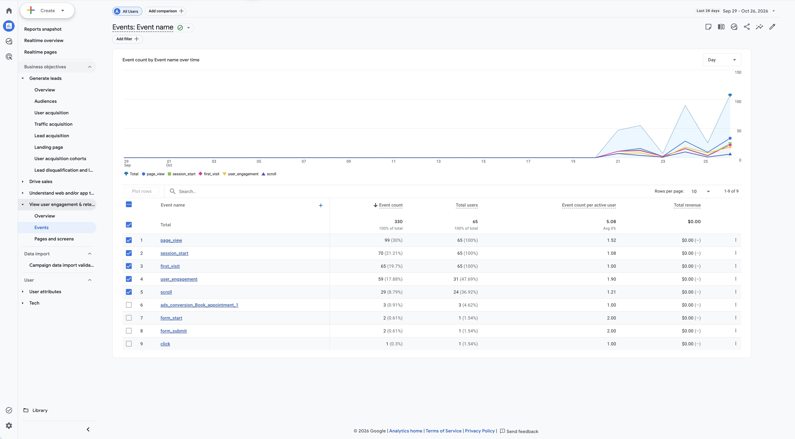

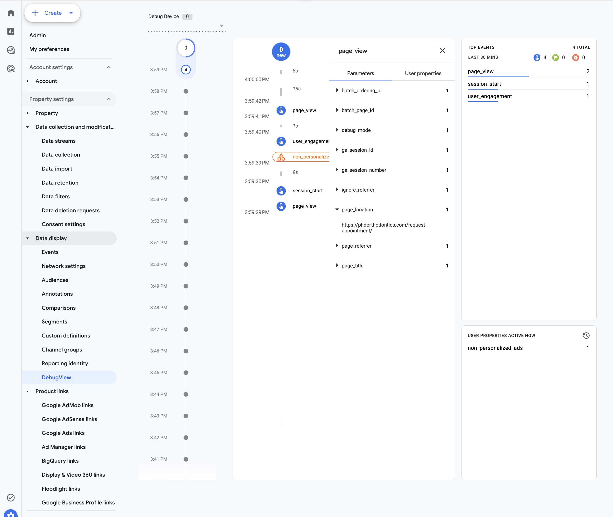

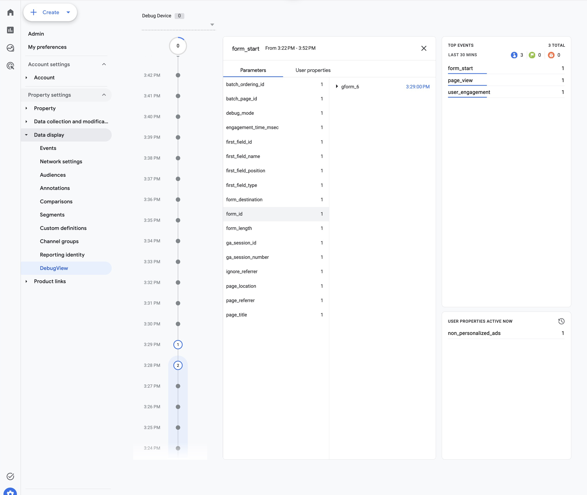

Overall assessment: PARTIAL — GA4 collection evidence available; direct GTM QA pending access. No GTM tags or triggers were modified or independently validated in this review.

## 1B. GA4 DebugView / Realtime — Pei Yun Chuang {#debug-team .unnumbered}

### 1B.1 Objective and method {.unnumbered}

This section validates whether key website events appeared in GA4 DebugView or Realtime, whether visible event parameters were populated, and whether available evidence supports the GA4-1 measurement objectives. Evidence consists of supplied DebugView and Realtime screenshots and GA4 Events/Funnel Events CSV exports. Historical event counts establish recorded activity but cannot independently prove successful form completion, trigger logic, or parameter-level correctness.

### 1B.2 Screenshot-backed QA checklist {.unnumbered}

| Event | Evidence / validation | QA status |
| --- | --- | --- |
| page_view | DebugView shows event; page_location and page_referrer visible; 99 historical events | PASS — observed |
| session_start | Realtime screenshot and 70 historical events | PASS — observed |
| user_engagement | DebugView shows engagement_time_msec = 18536 and ga_session_id; 59 historical events | PASS — observed |
| form_start | DebugView/Realtime event; form_id = gform_6; contact-us URL; 2 historical events | PASS — observed |
| scroll | 29 historical events; no expanded DebugView screenshot | PARTIAL |
| form_submit | 2 historical events from 1 user; no successful test submission in DebugView | NOT VERIFIED live |
| ads_conversion_Book_appointment_1 | 3 historical events; completed booking/trigger not demonstrated | NOT VERIFIED live |

Status meanings: PASS = observed event/parameter presence only; PARTIAL = historical evidence without full DebugView validation; NOT VERIFIED live = cannot confirm a successful live outcome. These statuses do not imply complete GA4-1 specification compliance.

### 1B.3 Parameter-level validation {.unnumbered}

| Event | Parameter | Observed value / evidence | Assessment |
| --- | --- | --- | --- |
| page_view | page_location | PhD Orthodontics website URL | Populated |
| page_view | page_referrer | Referring URL visible | Populated |
| user engagement | engagement_time_msec | 18536 | Numeric; populated |
| user engagement | ga_session_id | Session identifier visible | Populated |
| form_start | form_id | gform_6 | Populated |
| form_start | page_location | https://phdorthodontics.com/contact-us/ | Populated |
| form_start | ga_session_id | Session identifier visible | Populated |

These values demonstrate presence and plausible formatting, not guaranteed alignment with the original GA4-1 required-parameter list. The screenshots do not provide sufficient evidence to assert that every required parameter was populated correctly.

### 1B.4 Historical exports cross-check {.unnumbered}

The Events CSV contains a total of 330 events: page_view 99 (65 users), session_start 70 (65), first_visit 65 (65), user_engagement 59 (31), scroll 29 (24), ads_conversion_Book_appointment_1 3 (3), form_start 2 (1), form_submit 2 (1), and click 1 (1). The Funnel Events CSV places both form_start records on the Contact Us page, desktop, (direct) / (none), from one user. Two starts from one user are not, by themselves, proof of duplicate firing.

### 1B.5 GA4-1 measurement-plan consistency {.unnumbered}

The available GA4 data confirms that key events, including page_view, user_engagement, and form_start, were successfully recorded. Important parameters such as page_location, form_id, ga_session_id, and engagement_time_msec were also populated. These findings support the website's measurement objectives. However, the original GA4-1 parameter specifications were not available for a complete comparison. As a result, the measurement plan's full consistency remains unverified.

QA Status: Partial Pass

### 1B.6 Discrepancies, limitations, and actions {.unnumbered}

Form submission—pending: form_submit appears twice in historical exports, but no expanded DebugView evidence confirms a successful submission. Perform an authorized test and capture the event with parameters.

Appointment conversion—pending: Three ads_conversion_ Book_appointment_1 events appear in the export, but booking completion and trigger semantics are not established. Verify the conversion condition against the measurement plan.

Multiple web streams—review: The GA4 settings screenshot shows two web streams. Confirm which measurement ID is deployed to the live site before attributing discrepancies to event configuration.

Parameter completeness—pending: Several parameter values are visible, but not all expected GA4-1 fields can be checked from these screenshots.

Repeated form_start—review: Two form_start events from one user may reflect two valid interactions; reproduce and check for unintended duplication before classifying as a defect.

### 1B.7 Screenshot evidence (embedded) {.unnumbered}

The following figures are the actual screenshots supplied for this assignment. Figure captions identify the test or parameter shown; screenshots are not fabricated. The images provide evidence of observed events and selected parameter values, rather than proof of complete end-to-end conversion success.

The seven screenshots confirm that GA4 successfully tracks key events, including page_view, user_engagement, and form_start, with relevant parameters. The Events Report recorded 330 events from 65 users. Overall, event tracking is working, but form submissions and appointment conversions require further verification.


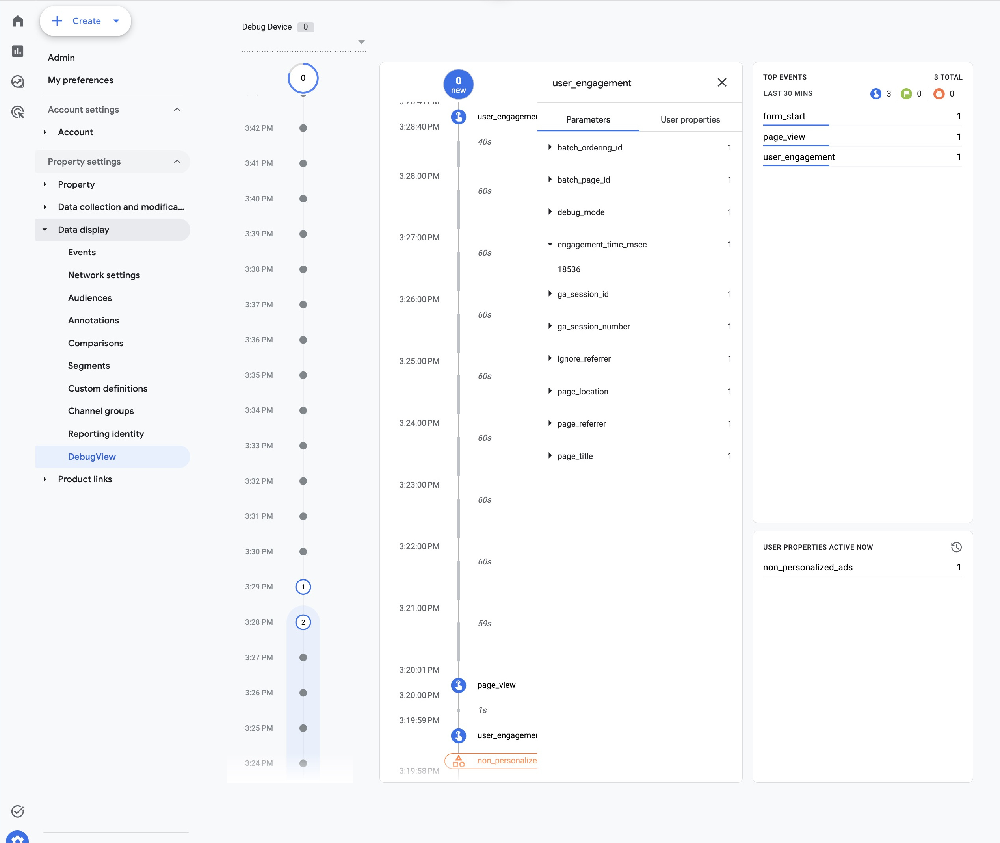

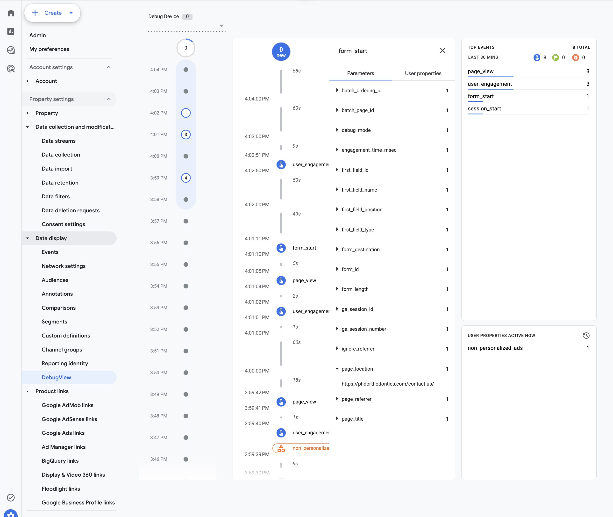

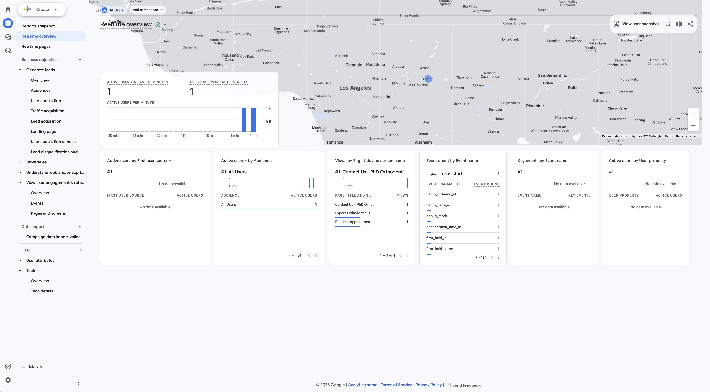


## 1C. GA4 Reporting Sanity Checks — Yujia Luo {#reporting-team .unnumbered}

### 1C.1 Objective and overall result {.unnumbered}

I reviewed the supplied GA4 report screenshots and CSV exports to check whether session source / medium, session campaign, page location, page title, and device category were populated and internally consistent. Overall status: PARTIAL PASS. All five dimensions contain values, but attribution gaps, temporary-host traffic, and test activity limit how confidently the clinic can interpret patient acquisition and website performance.

This is a review of supplied evidence, not a new live test. PASS means the dimension is populated and the stated cross-check passed; REVIEW means a discrepancy or limitation remains. No settings were changed and no fixes were verified.

### 1C.2 Reporting QA checklist {.unnumbered}

| Dimension and evidence | Observed result | Status |
| --- | --- | --- |
| Session source / medium<br> source-medium.csv; Figure C1 | 71 sessions and 330 events across 7 rows. Direct: 45 sessions; Google organic: 19; Bing organic: 3. One (not set) session. | REVIEW |
| Session campaign<br> campaign.csv; Figure C2 | business-profile has 1 referral session; organic, direct, referral, and ai-assistant labels populate. One (not set) session. Source / medium row totals match C1. | REVIEW |
| Page location<br> page-location.csv; Figure C3 | URLs populate; total 330 events, 65 users, 99 views. Four Bluehost URL variants contribute 43 events and 10 views. Query strings split some page rows. | REVIEW |
| Page title<br> page-title.csv; Figures C3 and C4 | All listed titles populate; totals reconcile to 330 events and 99 views. Dental Braces URL has English and Vietnamese title rows. | REVIEW |
| Device category<br> device-category.csv; Figure C5 | Desktop: 34 active users, 180 events; mobile: 31 active users, 150 events. No blank or (not set) device row in supplied export. | PASS |

### 1C.3 Cross checks and interpretation {.unnumbered}

Source / medium and campaign exports both sum to 71 sessions, 29 engaged sessions, 330 events, and 3 key events. The Events export records 70 session_start events; the one-session difference remains unresolved and is not enough to prove a collection defect. Compare identical report settings and session-level evidence before assigning a cause.

Desktop and mobile sum to 330 events and 3 key events, matching acquisition totals. Their engaged sessions sum to 29. The page-title export also totals 330 events and 99 views, matching the page-location Exploration. Active users in reports and total users in the Exploration are different metric labels; row-level user counts should not be treated as interchangeable or automatically additive.

### Reporting Findings and Follow Up {.unnumbered}

### 1C.4 Discrepancies and possible explanations {.unnumbered}

| Finding and priority | Evidence and interpretation | Recommended follow up |
| --- | --- | --- |
| Missing attribution<br> Medium | (not set): 1 of 71 sessions (1.41%), 7 events; campaign is also (not set). Missing acquisition context or session/event sequencing is a hypothesis, not an established cause. | Inspect the affected session and landing URL; check campaign inputs and session initialization. Retest before marking resolved. |
| Temporary host traffic<br> High | Bluehost variants: 43/330 events (13.03%) and 10/99 views (10.10%). Could reflect staging/testing or an earlier deployment; origin is unverified. | Confirm hostname history and deployed measurement IDs. Use a production-hostname comparison for analysis; prevent future staging data from mixing with production. |
| Test visits recorded<br> Medium | tagassistant.google.com / referral: 1 session, 3 events. A homepage URL containing gtm_debug has 3 events and 1 view. These may describe the same visit; do not add them as separate tests. | Review developer/internal traffic handling and maintain a QA test log. Validate any proposed exclusion before activation. |
| URL and title variation<br> Medium | Homepage base URL: 36 views; UTM/debug variants add 3, matching 39 title-report views. Appointment base URL: 5 views plus token variant: 1, matching 6. Dental Braces: English 2 events/2 views; Vietnamese 2 events/0 views. | Compare hostname and page path for content analysis; retain campaign context separately. Test translation/title timing and page_view behavior before declaring a defect. |
| Key event page context<br> High | All 3 key events in the page-title export appear on Meet Dr. Lu; Request Appointment shows 0. This does not establish completed bookings. | Coordinate with Members 1–2 to reproduce the booking journey and verify which action and page context trigger the key event. |

No (not set) page-location, page-title, or device-category row appears in the supplied exports. This confirms only the visible dataset; it does not establish that missing values never occur. Direct / (none) and campaign labels such as (organic) are not classified as defects merely because they contain parentheses. No paid campaign row is visible, so paid-campaign tracking is unverified.

### 1C.5 Implications for the CEP client {.unnumbered}

For my orthodontic client, reliable acquisition data is needed to assess whether SEO and local referral efforts bring prospective patients to the website. Google and Bing organic contribute 22 of 71 sessions (30.99%), but the high direct share (45/71, 63.38%) should not automatically be interpreted as brand awareness. Check campaign tagging before attributing these visits to a particular marketing effort.

Before evaluating consultation growth, prioritize production-only reporting and booking-event validation. Mobile accounts for 150/330 events (45.45%) and 2 of 3 key events, supporting a mobile booking-flow QA test, but the small sample and unverified conversion condition do not support a claim that mobile produces more completed appointments. These findings should feed Member 5’s issues log as open items.

Evidence sources: the five named CSV exports and screenshots embedded below, plus events.csv for the session_start cross-check. All proposed fixes remain pending; GA4-1 compliance cannot be fully assessed without the original measurement specification.

Seven source / medium rows include one (not set) session and one Tag Assistant referral. Exact values are recorded in the checklist.

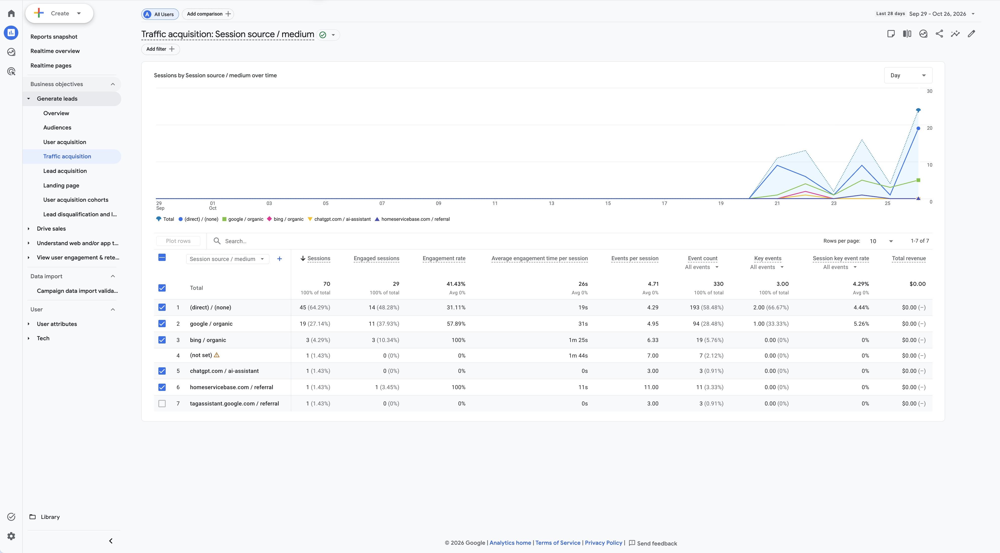

Source file: source-medium.jpeg. Supplied GA4 screenshot reproduced without changing report content.

Campaign values align with the source / medium rows; business-profile is recorded for homeservicebase.com / referral.

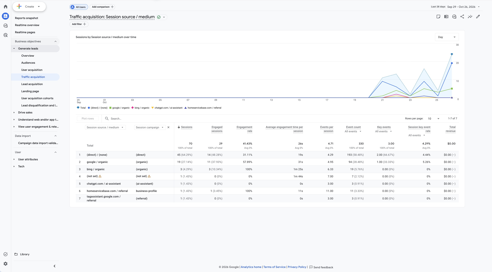

Source file: campaign.jpeg. Supplied GA4 screenshot reproduced without changing report content.

The Exploration displays production and Bluehost URLs, query-string variants, and a translated title. Refer to the original image or CSV for long URLs.

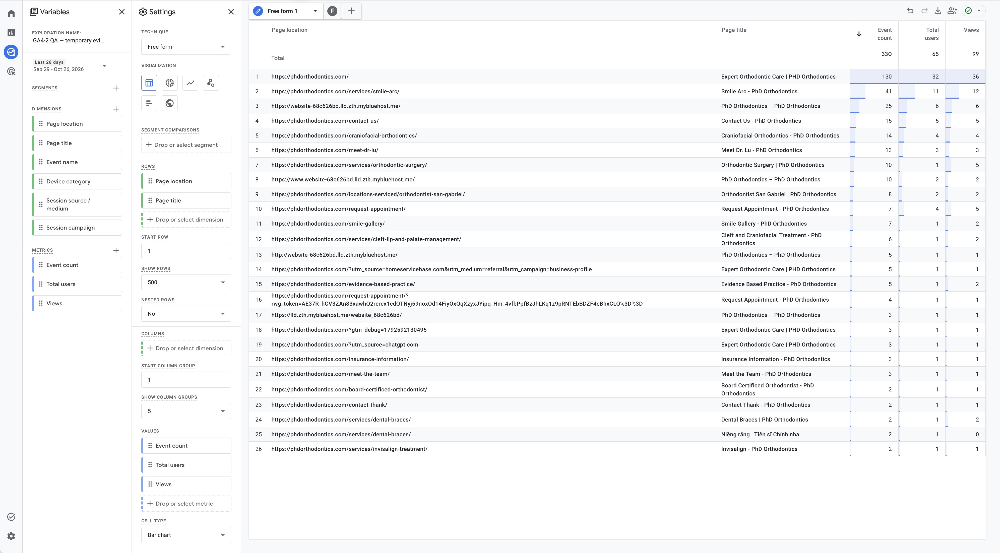

Source file: page-location-title-exploration.jpeg. Supplied GA4 screenshot reproduced without changing report content.

The report includes 39 homepage views, 6 appointment-page views, and 3 key events associated with Meet Dr. Lu.

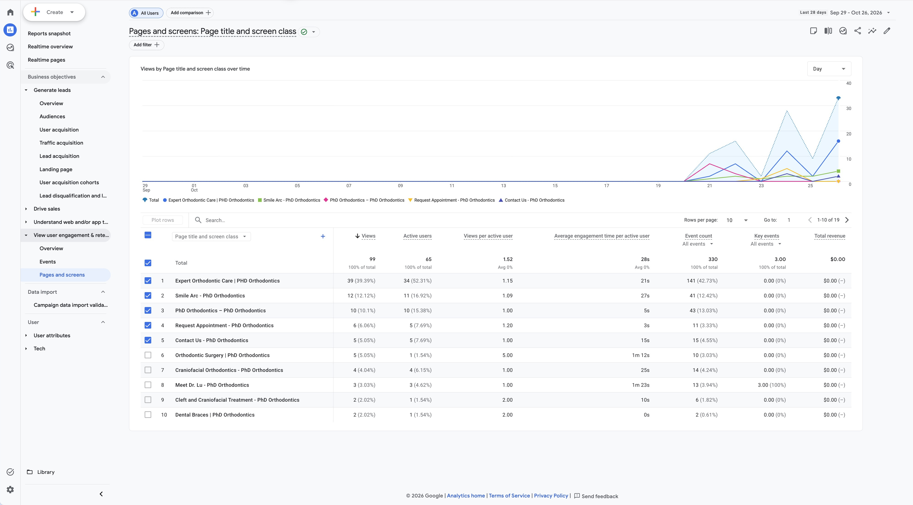

Source file: page-title.jpeg. Supplied GA4 screenshot reproduced without changing report content.

Desktop records 180 events and mobile 150 events. Both categories are populated.

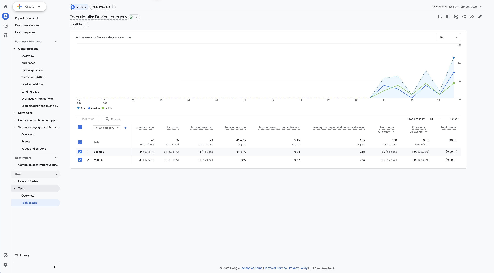

Source file: device-category.jpeg. Supplied GA4 screenshot reproduced without changing report content.

## 1D. BigQuery Export & Technical Issues — Hana {#bigquery-team .unnumbered}

*Member 4 — BigQuery Export & Technical Issues (Hana). The team Doc contains responsibilities only. The following existing evidence-backed content is retained from the prior report; no new export or technical QA was performed during integration.*

**BigQuery export was not active at the November 4, 2026 QA snapshot, so event-level warehouse validation could not yet be performed.** Admin → Product links → BigQuery links states “No links yet.” No export was created or enabled. There is no verified export project/dataset, no `events_*` query output, and no DebugView-to-warehouse reconciliation in this report.


| Check | Finding | Result |
|------------------------|------------------------|------------------------|
| Export link exists | No links yet | **NOT IMPLEMENTED** |
| Relevant events in `events_*` | No linked export to inspect | **NOT TESTABLE** |
| `UNNEST(event_params)` extraction | No actual export dataset available; no query run | **NOT TESTABLE** |
| Match event name/parameter/value to DebugView | No warehouse export available to compare with the supplied team DebugView evidence | **NOT TESTABLE** |

**Validation timing and owner:** After the client approves the canonical stream and export setup, the authorized GA4/GCP owner should create the link and grant appropriate access. Recheck when the first daily `events_YYYYMMDD` table appears; check intraday tables only if streaming is enabled. Export start time, timezone and table availability must be recorded; do not assume past data will backfill. On the first available approved QA date, the analytics team should:

1.  Run a bounded date-range event-name/count query for `consultation_cta_click`, `form_start`, and `generate_lead` using the actual project and dataset.
2.  Extract `cta_id`, `cta_location`, `form_id`, `lead_type`, `page_location` and `ga_session_id` using scalar subqueries over `UNNEST(event_params)`, reading the correct string/integer value type.
3.  Match each controlled test's event name, parameter key and actual value with the saved expanded DebugView event; account for export delay, consent and active filters.
4.  Group sessions by `user_pseudo_id` plus `ga_session_id`; flag missing identifiers and avoid combining daily/intraday copies twice.
5.  Apply the GA4-1 same-form/session sequence and deduplication rules before producing completion or attribution metrics. Publish actual SQL/output evidence only after execution; no placeholder dataset is presented as a result here.

### Retained Technical Configuration Snapshot

The prior November 4 review identifies GA4 property **540432856**, account **396896788**, displayed as **phdorthodontics.com**. It records a receiving web stream `G-XRPHCNHL18` (stream 15013125726) and a second, inactive stream `G-J1RJZW4VBV` (stream 16133876327). These dated Admin observations do not verify the deployment or GTM trigger logic discussed by Members 1–2.


The receiving stream's retained settings evidence shows enhanced measurement, including page views and form interactions, enabled; email redaction active; query-parameter key redaction inactive. Configuration is not proof that every outgoing value is safe or that the intended consultation form is correctly instrumented.


# Deliverable 2 — Issues Log

*Neutral integration of existing findings and the completed team sections. The Google Doc assigns this deliverable to Xueying Luo but contains no completed Issues Log; these rows are not presented as her authored work. No settings were changed or fixes verified during this integration.*

| ID | Issue / detection | Severity | Suspected cause / limitation | Action taken or proposed | Current status |
|---|---|---|---|---|---|
| QA-01 | Earlier browser certificate/inspection failure — retained technical snapshot | High | Hostname/redirect or local environment; root cause unconfirmed | Earlier `www` navigation partially restored access; retain vendor diagnosis and reliable retest requirement | Partially resolved; not re-tested during integration |
| QA-02 | Direct GTM access unavailable — 1A | High | Owning client container not available to current account | Team GA4 evidence retained; request GTM Preview access and inspect actual tags/triggers | Unresolved |
| QA-03 | GA4-1 CTA/success contract not fully established — 1A/1B | High | Available evidence does not establish planned CTA parameters or accepted-request semantics | Keep `consultation_cta_click` and `generate_lead` definitions; complete authorized trigger/parameter tests | Unresolved |
| QA-04 | Historical form/appointment events do not establish accepted requests — 1A/1B/1C | High | Trigger semantics unknown; all 3 key events in team page-title export appear on Meet Dr. Lu | Do not substitute `form_submit` or the Ads-named event for accepted requests/bookings; validate condition and page context | Unresolved |
| QA-05 | Parameter completeness / repeated starts — 1B | High | Selected parameters observed; two starts from one user do not establish duplication | Preserve PASS — observed and Partial Pass; reproduce same-form/session and duplicate cases | Partially resolved: selected event/parameter presence observed; complete specification unverified |
| QA-06 | Two streams and intended deployment require confirmation — 1A/1B | Medium | Parallel setup / owning deployment not confirmed by team evidence | Confirm live measurement ID and canonical stream before troubleshooting discrepancies | Unresolved |
| QA-07 | QA/test traffic recorded — 1C | Medium | Tag Assistant referral and debug URL may describe the same visit | Do not add as separate tests; review developer/internal handling and validate exclusions before activation | Unresolved |
| QA-08 | Warehouse dependency absent — retained 1D | Medium | No linked BigQuery export at recorded snapshot | Preserve no-link evidence; authorized owner to enable export and validate first available tables | Unresolved |
| QA-09 | Missing attribution — 1C | Medium | One `(not set)` session; acquisition context/sequencing is a hypothesis | Inspect affected session and landing/campaign context before assigning cause | Unresolved |
| QA-10 | Temporary-host traffic — 1C | High | Bluehost variants may reflect staging or earlier deployment; origin unverified | Confirm hostname history and use production-hostname comparisons | Unresolved |
| QA-11 | URL/title variants and session-count difference — 1C | Medium | Query/title timing and report settings may differ; cause unproven | Compare identical settings, paths, title timing and session-level evidence | Unresolved |

# Deliverable 3 — Remaining Risks & Mitigation Plan

*Existing integrated risk material retained because Member 5 has responsibilities only in the team Doc; this is not attributed as completed work by Xueying Luo.*

| Risk | Why it matters for KPIs or downstream analysis | Likely impact | Mitigation |
|------------------|------------------|------------------|------------------|
| Website/vendor dependency and certificate instability | Interrupted browsing or diagnostics can suppress observed funnel steps and delay QA acceptance | **High** | Vendor checks hostname certificate chain/redirects and local-environment differences; retest all three pages before interpreting changes in traffic or inquiries |
| CTA selector changes and desktop/mobile differences | CTA counts and funnel drop-off could become inconsistent across placements/devices | **High** | Approve static CTA codes and selectors; test header, hero/main and other actual placements separately on desktop/mobile after each site update |
| Enhanced measurement overlapping manual implementations | Duplicate views/starts inflate engagement and distort session/form relationships | **High** | Inspect the owning container; use one page-view strategy and one reliable form-start implementation; repeat-action and reload tests with parameter evidence |
| Embedded/provider form behavior or callback changes | A form opening/submit attempt can be mistaken for an accepted request, invalidating the inquiry KPI and Ads optimization | **High** | Confirm actual form/provider; use approved isolated callback tests; tie `generate_lead` to acceptance with same `form_id` and private deduplication token kept outside GA4 |
| Consent and browser privacy differences | Collection/session IDs can vary, biasing device comparisons, BigQuery paths and attribution | **High** | Test approved denied/granted consent states and major browsers; record consent mode/filter state and missing IDs; do not assume counts equal all real inquiries |
| Query strings/referrers may contain sensitive data | Healthcare-related URLs/payloads could expose personal information in GA4, exports or public evidence | **High** | Vendor audits data layer/outgoing payloads; sanitize URLs before collection; retain permitted campaign tags; verify query-key redaction and avoid capturing patient entries |
| Mixed streams and unverified legacy key-event semantics | Looker Studio and Ads reports could combine incompatible populations or label intent as success | **High** | Document canonical property/stream, review destination and legacy triggers with owner, and validate accepted-request semantics before downstream mapping |
| Manual UTMs, redirects and QA contamination | Channel/campaign comparisons and attribution can become misleading even when dimension values are populated | **Medium** | Use an approved naming register, check UTM/auto-tag preservation in controlled non-debug visits, and define prospective QA/internal traffic handling |
| Low volume, processing delay and lack of export history | Sparse results cannot establish tracking completeness; later BigQuery work may lack earlier data | **Medium** | Use bounded QA windows, record processing/export start times, keep absent categories explicit, and validate the first available export rather than assume backfill |
| Inquiry qualification and appointment linkage remain unvalidated | `generate_lead` alone cannot establish qualified leads, patients or bookings for CEP/ROI analysis | **High** | Obtain client-approved qualification rules and privacy-reviewed aggregate inquiry/CRM reconciliation; keep inquiry, qualification and appointment outcomes separate |

# Overall QA Status / Integration

**Overall: PARTIAL.** The team Doc is authoritative for completed 1A–1C. Its observation-only PASS results, Partial Pass, REVIEW and NOT VERIFIED live labels are preserved. The retained Member 4 evidence documents an unlinked BigQuery export; it does not claim warehouse validation.

The team evidence establishes recorded activity and selected parameters, not complete GA4-1 compliance, verified GTM trigger logic, successful requests, completed bookings, or duplicate prevention. In particular, `form_id = gform_6` on Contact Us is an observed value, while `form_id = consultation_request` is the GA4-1 proposed analytics code; their mapping is not accepted by this integration. CTA clicks, form starts, unverified `form_submit`, and `ads_conversion_Book_appointment_1` remain separate from confirmed consultation inquiries, booked appointments and qualified leads. `generate_lead` requires actual provider/server acceptance, matching form/session context and deduplication.

The team exports use **September 29–October 26, 2026**, as recorded in the local CSV headers. Their 71 sessions / 330 events replace the old individual reporting section; they are not blended with its later-period 152 sessions / 693 events. The team’s statement that the original GA4-1 specifications were unavailable to its review is retained as written; the current project does contain the blueprint, but this integration does not convert that availability into a completed compliance test.

## Contributions and Retained Material

| Member | Source / contribution represented here |
|---|---|
| Willy | Completed team Doc 1A, transferred in full |
| Pei Yun Chuang | Completed team Doc 1B, transferred in full |
| Yujia Luo | Completed team Doc 1C, transferred in full |
| Hana | Member 4 responsibilities in team Doc; existing assistant-supported BigQuery/technical findings retained for this section, not newly claimed as completed Doc content |
| Xueying Luo | Assigned Issues/Risks/Integration in team Doc; no completed authored section supplied. Neutral existing/integrated material retained without assigning authorship |

# Appendix {.unnumbered}

## Publication and Sources

- [GitHub Repository](https://github.com/hanamai111/ga4-analytics-blueprint-phd-orthodontics)
- [GitHub Pages — GA4-2](https://hanamai111.github.io/ga4-analytics-blueprint-phd-orthodontics/ga4-2-tracking-qa-log.html)
- [Authoritative team Google Doc](https://docs.google.com/document/d/1TJMisd3sketQyDZt0i1HE_h1A3tFrMPnauMFtu8FkkU/edit?usp=sharing)
- [GA4-1 measurement blueprint](ga4-1-analytics-blueprint.html)
- QMD: `ga4-2-tracking-qa-log.qmd`; rendered HTML: `docs/ga4-2-tracking-qa-log.html`.

## Evidence Register and Source Review Notes

The 13 team figure occurrences use 11 matching original local screenshot files under `images/ga4-2/team/`. Captions and substantive team text are retained. Images were matched to the Google Doc's embedded figures; unrelated later-period screenshots were not substituted. Existing Hana/technical screenshots and all prior evidence files remain on disk.

| Team figures | Local image |
|---|---|
| A1; B Figure 5 | `events.jpeg` |
| A2; B Figure 1 | `debugview-page_view-page_location.jpeg` |
| A3 | `debugview-form_start-form_id.jpeg` |
| B Figure 2 | `debugview-user_engagement-engagement_time_msec.jpeg` |
| B Figure 3 | `debugview-form_start-page_location.jpeg` |
| B Figure 4 | `realtime-form_start-parameters.jpeg` |
| C1 | `source-medium.jpeg` |
| C2 | `campaign.jpeg` |
| C3 | `page-location-title-exploration.jpeg` |
| C4 | `page-title.jpeg` |
| C5 | `device-category.jpeg` |

**Manual source checks:** Section 1B says “seven screenshots,” but the current Doc embeds five numbered figures in that section. Its Figure 4 caption says DebugView, while the supplied image is Realtime. Both source statements/caption are preserved; no missing figure was fabricated. Confirm these two editorial points with the team before submission. Long event-name line wrapping in the checklist was joined to preserve the single identifier `ads_conversion_Book_appointment_1`.

CSV sources inspected locally: `events.csv`, `funnel-events.csv`, `source-medium.csv`, `campaign.csv`, `page-location.csv`, `page-title.csv`, and `device-category.csv`, under the supplied `GA4-2-Tracking-QA/exports/` folder. The files remain intact; team values are copied as written rather than recalculated or replaced. Raw CSVs are not newly published by this integration.

Member 4/5 task-assignment placeholders were not substituted for completed evidence. The substantive 1A–1C source text and every table row were checked again against the current team Doc after transfer. No Google Doc edits, GTM/GA4 configuration changes, new QA investigation, or Canvas upload/submission were performed.
